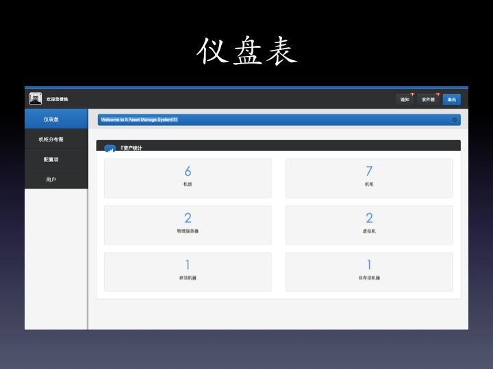
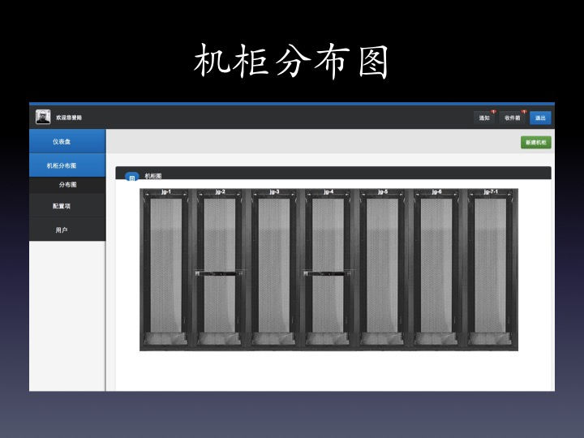
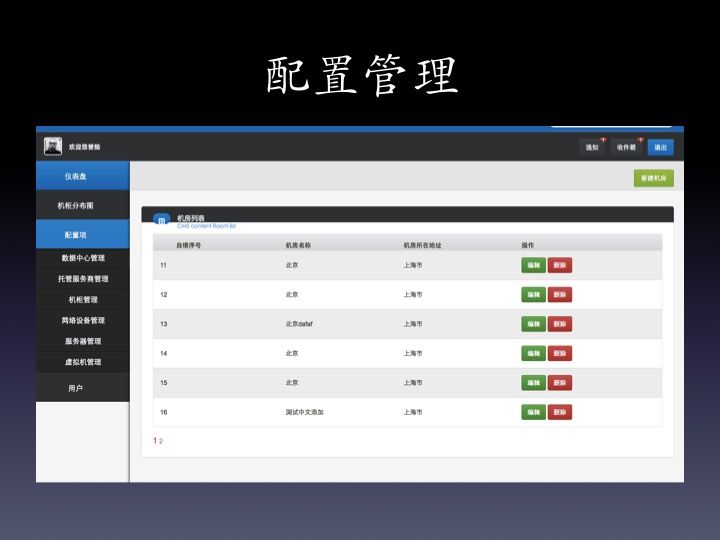
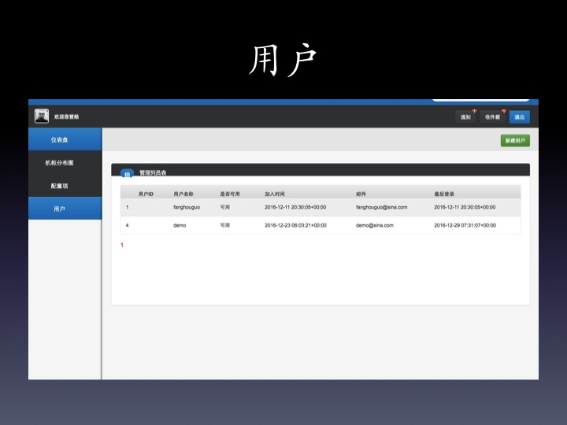

注意：本系统属于测试项目，不适合生产环境

IT资产管理系统使用说明

1.本系统需要使用Python Django、Python MySQL-db、Bootstrap3、Jquery等模块支持

2.支持原生Django部署且同时也支持Nginx+Wsgi方式部署

3.模块安装：

git clone https://github.com/iwordz/it_asset

cd it_asset

导入 it_asset.sql mysql数据库文件

下面开始安装Django类库:

pip install django==1.7

pip install MySQL-Python(如果执行上面命令出现找不到"EnvironmentError: mysql_config not found"等字样，则需要执行export PATH=$PATH:
/path/mysql/bin 注意path是你mysql安装的实际目录。)

4.本系统已经在Mac OSX和Centos上进行过测试

5.部分功能界面预览

5.1仪表盘功能

5.2机柜分布图

5.3配置项管理

5.4用户管理

6.正式发布

打开setting.py设置如下参数： DEBUG=False ALLOWED_HOSTS = ["*"]

7.本系统部分使用了开源系统，如有侵犯您的版本，请联系我删除，谢谢合作！

8.本系统仅仅是一个实验性的演示系统，不作为正式环境产品。感谢您的参与。如果在测试过程中遇到任何问题，请与我联系。（email:houguofang@gmail.com）

[东白随记](https://blog.tinygo.tech)

[CAP怎么选](https://blog.tinygo.tech/article/7981)

[Kafka是如何实现高吞吐率的](https://blog.tinygo.tech/article/7979)

[高并发系统的设计与实现](https://blog.tinygo.tech/article/7977)

[prometheus架构中有哪些组件以及各个组件有什么用](https://blog.tinygo.tech/article/7963)

[Client如何实现长连接](https://blog.tinygo.tech/article/7939)

[TCP和UDP有什么区别](https://blog.tinygo.tech/article/7927)

[InnoDB的行锁模式](https://blog.tinygo.tech/article/7908)

[Goroutine发生了泄漏如何检测](https://blog.tinygo.tech/article/7885)

[Go值接收者和指针接收者的区别](https://blog.tinygo.tech/article/7873)

[Go中的逃逸分析是什么](https://blog.tinygo.tech/article/7871)

[处理C10k问题的策略有哪些？](https://blog.tinygo.tech/article/7810)

[为什么事件驱动的架构能提高可扩展性(scalability)？](https://blog.tinygo.tech/article/7804)

[写一段有内存泄漏的示例代码。](https://blog.tinygo.tech/article/7796)

[如果要你组织一个弹性工作制的开发团队（即没有强制工作时间的要求），并且假期制度是"按需休假"，你会如何做？](https://blog.tinygo.tech/article/7786)

[你在什么时候会使用Request/Response模式，什么时候使用Publish/Subscribe模式？](https://blog.tinygo.tech/article/7775)

[什么是敏捷（Agility）？](https://blog.tinygo.tech/article/7773)

[什么是rebase？](https://blog.tinygo.tech/article/7755)

[什么情况下你会使用类似于MongoDB的文档数据库而不是关系型数据库（如Mysql或者PostgreSQL）？](https://blog.tinygo.tech/article/7750)

[web相关问题: \[↑\]](https://blog.tinygo.tech/article/7737)

[什么是栈？什么是堆？](https://blog.tinygo.tech/article/7732)

[讨论一下，如何写一个循环，然后把它转换成递归函数，要避免易变性。](https://blog.tinygo.tech/article/7725)

[什么是高阶函数？有什么用途？用你的首选语言写个例子出来。](https://blog.tinygo.tech/article/7724)

[告诉我你的首选语言的三个最坏的缺陷。](https://blog.tinygo.tech/article/7718)

[空对象模式(Null Object Pattern)的目的是什么？](https://blog.tinygo.tech/article/7705)

[一个"专业的开发者"意味着什么？](https://blog.tinygo.tech/article/7691)

[你更喜欢在全新项目（Green Field Project）上工作还是在已有项目(Brown Field Project)基础上工作？为什么？](https://blog.tinygo.tech/article/7688)

[列出最近你读过的5本书。](https://blog.tinygo.tech/article/7683)

[所有的设计中都会有美学元素(aesthetic element)的存在。问题是，你认为美学元素是你的朋友还是敌人？](https://blog.tinygo.tech/article/7681)

[实时语言(real-time language)和堆内存分配(heap memory allocation)之间的关系是什么？](https://blog.tinygo.tech/article/7665)

[封装的重要性体现在哪儿？](https://blog.tinygo.tech/article/7663)

[Rust中的网络库（如Hyper, reqwest）如何使用？](https://blog.tinygo.tech/article/7619)

[如何在Rust中实现TCP/UDP客户端和服务器？](https://blog.tinygo.tech/article/7617)

[使用Rust如何实现无锁数据结构？](https://blog.tinygo.tech/article/7616)

[如何安装和配置Rust开发环境？](https://blog.tinygo.tech/article/7543)

[常见错误与调试](https://blog.tinygo.tech/article/7512)

[如何在Go中使用测试数据驱动开发（TDD）？](https://blog.tinygo.tech/article/7502)

[如何避免Go程序中的死锁（deadlock）？](https://blog.tinygo.tech/article/7494)

[Go社区常用的开发工具和编辑器插件有哪些？](https://blog.tinygo.tech/article/7480)

[社区趋势与最佳实践](https://blog.tinygo.tech/article/7478)

[如何编写安全的Go代码？](https://blog.tinygo.tech/article/7468)

[Go语言中的数据库驱动有哪些？如何使用？](https://blog.tinygo.tech/article/7458)

[Go语言的内存管理机制如何工作？](https://blog.tinygo.tech/article/7447)

[Go中的结构体（struct）如何使用，如何嵌套结构体？](https://blog.tinygo.tech/article/7434)

[Go中的接口（interface）是什么？如何定义和使用？](https://blog.tinygo.tech/article/7430)

[Go语言的切片（slice）和数组（array）有什么区别？](https://blog.tinygo.tech/article/7424)

[Go语言中的原子操作（atomic operations）如何使用？](https://blog.tinygo.tech/article/7415)

[其他](https://blog.tinygo.tech/article/7411)

[Go语言的常见面试题有哪些？](https://blog.tinygo.tech/article/7410)

[社区和资源](https://blog.tinygo.tech/article/7397)

[如何在Go中使用测试数据驱动开发（TDD）？](https://blog.tinygo.tech/article/7380)

[Go中的错误处理与Java或Python的异常处理有何不同？](https://blog.tinygo.tech/article/7365)

[Go社区常用的开发工具和编辑器插件有哪些？](https://blog.tinygo.tech/article/7359)

[如何使用Go和gRPC构建微服务？](https://blog.tinygo.tech/article/7353)

[使用Go开发时如何进行日志管理和监控？](https://blog.tinygo.tech/article/7341)

[Go语言中的常用Web框架有哪些？](https://blog.tinygo.tech/article/7330)

[Go的编译器优化有哪些注意事项？](https://blog.tinygo.tech/article/7322)

[如何在Go中处理HTTP请求和响应？](https://blog.tinygo.tech/article/7321)

[如何优化Go程序的性能？](https://blog.tinygo.tech/article/7320)

[如何在Go中处理JSON数据？](https://blog.tinygo.tech/article/7317)

[Go语言中的Context包如何使用？](https://blog.tinygo.tech/article/7315)

[Go语言有哪些常用的编码规范？](https://blog.tinygo.tech/article/7286)

Go语言（Golang）在开发过程中，为了保持代码的可读性、可维护性和一致性，有一套常用的编码规范。

[如何找出应用中开销最大的查询？](https://blog.tinygo.tech/article/7748)

[如何使用Python中的Scikit-Learn进行情感分析？](https://blog.tinygo.tech/article/4174)

使用Scikit-Learn进行情感分析通常涉及以下步骤： 1. 数据准备：首先，你需要一个包含情感标签的数据集。

[如何在Python中使用NLTK库进行文本处理？](https://blog.tinygo.tech/article/1031)

Python的NLTK（Natural Language Toolkit）库是一个强大的文本处理工具，可以用于各种自然语言处理任务。

[鸡娃真的能突破阶层问题吗？](https://blog.tinygo.tech/article/2128)

毕业生M，参加了安徽某市的2023年中考，考试成绩比较满意（涉及到隐私具体成绩就不公布了），家里还算满意。最近几天正在向着自己满意的学校进军。也算是一个比较好的结局了。期待三年高考能正常发挥，考取一个满意的高校。

[如何使用Python实现中文分词和词性标注？](https://blog.tinygo.tech/article/145)

在Python中实现中文分词和词性标注，我们可以使用一些现有的库来完成。

[如何使用Python对自然语言文本进行分词？](https://blog.tinygo.tech/article/791)

在Python中，对自然语言文本进行分词通常使用一些特定的库，如jieba库、结巴分词、NLTK（Natural Language Toolkit）等。

[如何使用Rust编写高性能的网络应用？](https://blog.tinygo.tech/article/7568)

[如何使用Python中的NLTK库对文本进行自然语言处理？](https://blog.tinygo.tech/article/148)

NLTK（Natural Language Toolkit）是一个非常强大的Python库，用于进行自然语言处理（NLP）的许多任务。

[如何使用Python实现中文分词和词性标注？](https://blog.tinygo.tech/article/37)

在Python中实现中文分词和词性标注，通常需要使用专门的中文处理库。

[如何在Python中使用NLTK进行自然语言处理？](https://blog.tinygo.tech/article/1797)

Python中的Natural Language Toolkit（NLTK）是一个强大的库，用于进行自然语言处理（NLP）的各种任务。

[怎么样才能用Python完成自然语言处理任务，比如词性标注或命名实体识别？](https://blog.tinygo.tech/article/1858)

要使用Python完成自然语言处理（NLP）任务，如词性标注或命名实体识别，通常需要借助一些强大的库和工具。

[城市社交之终极思考](https://blog.tinygo.tech/article/3007)

现在在某些大城市会形成一种恶习：就是把大把的时间浪费在这种无效的社交上，而不去真正学习一门知识，哪怕去学习如何制作一个相对完美的PPT也是不错的，还有的人去问一些问题其实在搜索引擎都是可以学习到的，干嘛不去搜索一下，毕竟现在网络是无处不再的嘛。所以要擅长利用网络去学习知识。而不是用网络去作无用的时间或者浪费时间。

[如何使用Python编写程序对中文文本进行情感极性分析？](https://blog.tinygo.tech/article/1817)

在Python中，对中文文本进行情感极性分析通常需要使用一些专门的库，如\`SnowNLP\`、\`jieba\`和\`TextBlob\`等。

[goroutine是什么，如何创建？](https://blog.tinygo.tech/article/7231)

goroutine是Go语言中的轻量级线程，它由Go运行时（runtime）进行调度和管理。

[如何进行代码覆盖率分析？](https://blog.tinygo.tech/article/7251)

代码覆盖率分析是一种测试方法，它测量代码中被执行或被测试到的比例。

[怎样用Python将一个字符串转换成小写字母格式？](https://blog.tinygo.tech/article/1464)

在Python中，你可以使用\`lower()\`方法来将一个字符串转换成小写字母格式。

[如何处理包的版本冲突？](https://blog.tinygo.tech/article/7265)

处理包的版本冲突是软件开发和项目维护中常见的挑战。

[如何使用Python进行自然语言处理？](https://blog.tinygo.tech/article/1952)

自然语言处理（NLP）是人工智能和语言学的交叉领域，主要研究如何让计算机理解和生成人类语言。

[Go在云计算和大数据领域有哪些应用？](https://blog.tinygo.tech/article/7278)

Go语言在云计算和大数据领域有着广泛的应用，主要体现在以下几个方面： 1. 云计算： \* 微服务架构：Go语言非常适合构建微服务架构，因为它具有简洁的语法、高效的性能和良好的并发支持。

[如何使用Python进行中文分词？](https://blog.tinygo.tech/article/127)

在Python中进行中文分词，你可以使用一些现成的中文分词工具，如jieba、THULAC、HanLP等。

[Mutex和RWMutex有何区别？](https://blog.tinygo.tech/article/7235)

Mutex（互斥锁）和RWMutex（读写锁）是两种不同类型的锁，它们在并发编程中用于保护共享资源，以防止数据竞争和不一致。

[如何使用Python进行自然语言处理？](https://blog.tinygo.tech/article/475)

Python是一种非常适合进行自然语言处理（NLP）的编程语言，因为它有许多强大的库和工具可供使用。

[数据抽象(Data Abstraction)能力是指能改变实现而不影响客户端的这种能力。请构造一个一个例子，违反这个特性，并且尝试修复它。](https://blog.tinygo.tech/article/7711)

[Go的垃圾回收机制是怎样的，如何调优？](https://blog.tinygo.tech/article/7253)

Go语言的垃圾回收机制是一种并发式、标记清除的垃圾回收机制，其设计目标是低延迟和高效率。

[如何在高校或企业中推广Go语言？](https://blog.tinygo.tech/article/7531)

[什么是反腐败层(Anti-corruption Layer)?](https://blog.tinygo.tech/article/7706)

[如何用Python实现情感分析？](https://blog.tinygo.tech/article/1323)

情感分析（Sentiment Analysis）是一种自然语言处理（NLP）技术，用于确定文本或语音中的情感倾向。

[如何使用Python编写一个简单的自然语言处理程序？](https://blog.tinygo.tech/article/1665)

要使用Python编写一个简单的自然语言处理（NLP）程序，你需要遵循几个步骤。

[《高性能Mysql》读书笔记](https://blog.tinygo.tech/article/7298)

READ UNCOMMITTED（未提交读），同事务中某个语句的修改，即使没有提交，对其他事务也是可见的。这个也叫脏读。 READ COMMITTED（提交读），另一个事务只能读到该事务已经提交的修改，是大多数据库默认的隔离级别。但是有下列问题，一个事务中两次读取同一个数据，由于这个数据可能被另一个事务提交了两次，所以会出现两次不同的结果，所以这个级别又叫做不可重复读。这里的不一样的数据包括虚读（两次结果不同）和幻读（出现新的或者缺少了某数据）。 REPEATABLE READ（可重复读），这个级别不允许脏读和不可重复读，比如MYSQL中通过MVCC来实现解决幻读问题。 SERIALIABLE（可串行化），这儿实现了读锁，级别最高。 显示和隐式锁定：事务执行中，随时可以执行锁定，锁只有在COMMIT或ROLLBACK的时候才释放，而且所有的锁是同时释放的。这些锁定都是隐式锁定。也可以通过特定语句显式锁定，比如SELECT … LOCK IN SHARE MODE等。

[突发！！！！阿里云新加坡数据中心突发火灾，新加坡可用区C机房火灾,故障处理进展三](https://blog.tinygo.tech/article/7657)

【进展更新】09月13日18:30，一层硬件设备正在安全迁移进行中。运维人员已获准进入二楼，完成勘查工作，在保全工作后将启动二层机器设备的安全迁移。

[如何使用Python进行自然语言处理？](https://blog.tinygo.tech/article/1423)

Python是一种非常适合进行自然语言处理（NLP）的编程语言，因为其拥有大量的库和框架可以帮助你轻松地处理和分析文本数据。

[Go支持函数作为一等公民吗？](https://blog.tinygo.tech/article/7224)

是的，Go语言支持函数作为一等公民。

[可变参数函数如何实现？](https://blog.tinygo.tech/article/7222)

在许多编程语言中，你可以实现可变参数函数（或称为变长参数函数、不定长参数函数等）。

[如何在Python中使用NLTK库将一段英文文本进行分词并统计各个单词的频率？](https://blog.tinygo.tech/article/830)

在Python中，使用NLTK（Natural Language Toolkit）库进行英文文本的分词和单词频率统计是一个常见的任务。

[如何使用Python进行情感分析，并根据结果作出相应的决策？](https://blog.tinygo.tech/article/4518)

在Python中进行情感分析并基于结果作出相应决策，你可以使用自然语言处理（NLP）库和机器学习模型。

[如何平衡个人职业发展与公司内部挑战之间的关系？](https://blog.tinygo.tech/article/7652)

她的职业轨迹表明，在谷歌这样的公司，快速晋升和高收入是可能的，尤其是对于表现出色且具备关键技能的工程师而言。她从 L3 快速晋升到 L6，并获得了大量的财务收益和丰富的技术与管理经验。这些收获不仅包括物质回报，还有对大型网站系统的深刻理解和一流的处理生产问题的能力。

[如何使用Python实现自然语言处理任务？](https://blog.tinygo.tech/article/656)

在Python中实现自然语言处理（NLP）任务需要多个步骤，这些步骤通常涉及文本的预处理、训练模型以及评估模型。

[如何在Go中使用第三方库（如Gin, Echo, Cobra）？](https://blog.tinygo.tech/article/7526)

[如何构建和部署Go应用程序？](https://blog.tinygo.tech/article/7256)

构建和部署Go应用程序的步骤通常包括以下几个主要阶段：开发、构建、测试、部署和运行。

[Rust中的异步编程如何用于编写聊天应用程序？](https://blog.tinygo.tech/article/7596)

[如何使用Python中的NLTK库来分析文本数据？](https://blog.tinygo.tech/article/2009)

Python中的NLTK（Natural Language Toolkit）库是一个强大的文本分析和自然语言处理库，它可以用来处理各种文本数据。

[如何使用Python编写一个简单的自然语言处理应用程序？](https://blog.tinygo.tech/article/738)

自然语言处理（NLP）是一个广泛的领域，涵盖了许多不同的技术和应用。

[如果让你来设计一个去中心化的P2P系统，你会如何设计？](https://blog.tinygo.tech/article/7812)

[如何利用Python进行自然语言处理？](https://blog.tinygo.tech/article/160)

Python是一种非常强大的编程语言，广泛用于自然语言处理（NLP）领域。

[channel在并发编程中扮演什么角色？](https://blog.tinygo.tech/article/7233)

在并发编程中，\`channel\`扮演着非常重要的角色。

[如何使用NLTK在Python中进行词性标注？](https://blog.tinygo.tech/article/727)

使用NLTK (Natural Language Toolkit) 在Python中进行词性标注的步骤通常很简单。

[AI写作、硕士、博士论文是否靠谱？](https://blog.tinygo.tech/article/3009)

结论一： 首先让AI写创新性的论文，尤其是博士论文，基本是不可能完成，大家把它当作查找资料的助手或者资料库查询。前提一个好的prompt对于答案的准确性是非常重要的。另外对于AIGC输出的内容真实性、合理性、正确性与否都要有辨别能力。最近也在体验写论文与写长篇文章，尤其是带图文的文章。

[如何使用Python中的NLTK库分词一段英文文本？](https://blog.tinygo.tech/article/1837)

在Python中，使用NLTK（Natural Language Toolkit）库进行英文文本的分词（Tokenization）是一个相对简单的任务。

[如何用Python对自然语言文本进行分类？](https://blog.tinygo.tech/article/1525)

对自然语言文本进行分类是一个复杂的任务，通常涉及到自然语言处理（NLP）的多个方面。

[Go在嵌入式开发中的探索之Tinygo介绍](https://blog.tinygo.tech/article/4644)

TinyGo是一个专为嵌入式系统和WebAssembly设计的Go编译器

[如何在Go中处理“nil pointer dereference”错误？](https://blog.tinygo.tech/article/7392)

[如何将自然语言文本转化为Python中可用的向量形式？](https://blog.tinygo.tech/article/1422)

将自然语言文本转化为Python中可用的向量形式是一个非常重要的步骤，尤其是在机器学习和自然语言处理(NLP)中。

[关于迪米特法则(最少知识原则): 写一段代码违反它, 然后修复它。](https://blog.tinygo.tech/article/7703)

[如何使用Python库NLTK实现自然语言处理中的词性标注？](https://blog.tinygo.tech/article/1244)

使用Python的NLTK（Natural Language Toolkit）库来实现自然语言处理中的词性标注是非常简单和直接的。

[如何编写和运行单元测试？](https://blog.tinygo.tech/article/7247)

编写和运行单元测试是一个非常重要的软件开发过程，它可以帮助我们确保代码的质量和稳定性。

[如何使用Python和深度学习框架TensorFlow实现对社交媒体上用户评论的情感分析，并给出积极、消极或中性的情感标签？](https://blog.tinygo.tech/article/3613)

要使用Python和TensorFlow进行社交媒体用户评论的情感分析，你需要遵循以下步骤： 1. 数据准备 首先，你需要一个包含社交媒体用户评论的数据集。

[MicroService架构的优劣是什么？](https://blog.tinygo.tech/article/7829)

[Go中new和make的区别](https://blog.tinygo.tech/article/7879)

[如何在Rust中使用WebAssembly？](https://blog.tinygo.tech/article/7640)

[如何使用Python进行自然语言处理？](https://blog.tinygo.tech/article/1573)

Python是一种非常适合进行自然语言处理（NLP）的编程语言，因为其拥有大量的库和框架可以帮助你轻松地处理和分析文本数据。

[如何使用Python进行自然语言处理？](https://blog.tinygo.tech/article/1853)

自然语言处理（NLP）是人工智能领域的一个分支，它涉及到计算机理解和处理人类语言的技术。

[Go中的错误处理机制是怎样的？](https://blog.tinygo.tech/article/7226)

Go语言中的错误处理机制是一种重要的编程范式，它通过显式地处理错误来提高程序的健壮性和可维护性。

[Rust中的垃圾回收机制是如何实现的？](https://blog.tinygo.tech/article/7566)

[如何使用Python NLTK库对文本进行分词和词性标注？](https://blog.tinygo.tech/article/1216)

使用Python的NLTK（Natural Language Toolkit）库进行文本分词和词性标注是一个相对简单的过程。

[XML数据的解析和生成在Go中如何实现？](https://blog.tinygo.tech/article/7274)

在Go语言中，XML数据的解析和生成主要使用标准库中的\`encoding/xml\`包。

[如何使用Python对文本数据进行情感分析？](https://blog.tinygo.tech/article/1922)

使用Python对文本数据进行情感分析是一个复杂的任务，通常涉及多个步骤。

[如何在Go中使用WebAssembly？](https://blog.tinygo.tech/article/7516)

[如何使用Python编写一个能够识别情感的自然语言处理程序？](https://blog.tinygo.tech/article/58)

编写一个能够识别情感的自然语言处理程序（NLP程序）通常涉及到机器学习和深度学习的复杂算法。

[如何用Python实现自然语言处理？](https://blog.tinygo.tech/article/1054)

自然语言处理（NLP）是一个涉及机器理解和生成人类语言的广泛领域。

[如何使用Python将文本转换为向量表示？](https://blog.tinygo.tech/article/1581)

在Python中，将文本转换为向量表示（也称为文本向量化）通常涉及使用诸如词袋模型（Bag of Words）或TF-IDF（词频-逆文档频率）等方法。

[如何将自然语言转换为计算机可以理解的形式，并使用Python库进行文本预处理、分词、去除停用词等操作？](https://blog.tinygo.tech/article/804)

将自然语言转换为计算机可以理解的形式，通常需要进行一系列的文本处理和预处理步骤。

[如何在Python中实现中文分词？](https://blog.tinygo.tech/article/1150)

在Python中实现中文分词可以使用多种方法，包括使用现成的分词工具或库，或者使用自定义的方法。

[如何编写一个简单的TCP服务器？](https://blog.tinygo.tech/article/7242)

编写一个简单的TCP服务器需要用到编程语言和一些基本的网络知识。

[如何使用Python实现一个简单的自然语言处理系统？](https://blog.tinygo.tech/article/1791)

实现一个简单的自然语言处理系统，你需要几个主要的步骤，包括预处理、特征提取、模型训练和结果输出。

[接口（interface）在Go中是如何工作的？](https://blog.tinygo.tech/article/7214)

在Go语言中，接口（interface）是一种类型，它定义了一组方法的集合。

[如何使用 Python 中的 NLTK 库对一段英文文本进行词性标注？](https://blog.tinygo.tech/article/723)

在Python中，使用NLTK（Natural Language Toolkit）库对一段英文文本进行词性标注是一个相对简单的任务。

[对手是现代语言，你的任务是要为Cobol辩护，你会如何进行？](https://blog.tinygo.tech/article/7838)

[并发性能瓶颈如何定位和解决？](https://blog.tinygo.tech/article/7254)

并发性能瓶颈的定位和解决是一个复杂的任务，需要一系列的步骤和工具来分析并确定性能瓶颈的原因，然后采取相应的措施来优化和解决。

[如何用Python在文本中提取关键词并进行情感分析？](https://blog.tinygo.tech/article/973)

在Python中提取文本关键词并进行情感分析需要几个步骤。

[如何使用Python对用户评论进行情感分析，判断其态度是正面还是负面？](https://blog.tinygo.tech/article/4947)

使用Python对用户评论进行情感分析并判断其态度是正面还是负面，通常需要借助一些情感分析库或API。

[使用Go实现一个简单的消息队列服务。](https://blog.tinygo.tech/article/7542)

[使用Go语言开发时如何与其他语言（如Python, C++）进行互操作？](https://blog.tinygo.tech/article/7509)

[如何处理HTTP请求和响应？](https://blog.tinygo.tech/article/7243)

处理HTTP请求和响应主要涉及到服务器和客户端之间的通信。

[如何使用select语句处理多个channel？](https://blog.tinygo.tech/article/7236)

在许多编程和数据处理环境中，\`SELECT\` 语句通常用于从数据库或其他数据源中检索数据。

[使用Python，如何进行文本分类任务？](https://blog.tinygo.tech/article/1457)

使用Python进行文本分类任务通常涉及到自然语言处理（NLP）的相关技术和工具。

[Go支持哪些基本数据类型？](https://blog.tinygo.tech/article/7213)

Go语言支持以下基本数据类型： 1. 整数类型（Int）：包括\`int\`、\`int8\`、\`int16\`、\`int32\`和\`int64\`等，用于表示不同大小的整数。

[Go语言如何实现函数式编程风格？](https://blog.tinygo.tech/article/7540)

[如何看待国内后台开发从Java转向Go的趋势？](https://blog.tinygo.tech/article/3010)

这篇文章主要从一个经验丰富的程序员的角度，对比了Java和Go两种编程语言，并分析了为什么有些团队或个人会选择从Java转向Go。

[如何在Go中进行机器学习（如使用Gorgonia）？](https://blog.tinygo.tech/article/7519)

[Rust社区的热门博客、播客和讨论组有哪些？](https://blog.tinygo.tech/article/7644)

[如何优化Go程序的启动时间？](https://blog.tinygo.tech/article/7283)

优化Go程序的启动时间主要涉及到几个方面：编译优化、代码优化、内存管理以及并发处理。

[安全相关问题: \[↑\]](https://blog.tinygo.tech/article/7830)

[语言的主要设计目标是什么？](https://blog.tinygo.tech/article/7212)

语言的主要设计目标通常取决于该语言的类型、应用领域以及其开发团队的初衷。

[如何使用Python进行自然语言处理？](https://blog.tinygo.tech/article/1933)

Python是一种非常适合进行自然语言处理（NLP）的编程语言，因为它有许多强大的库和工具可供使用。

[vue3 中 a超链接 提示“not found 404”](https://blog.tinygo.tech/article/7649)

在 Vue 3 使用 vue-router 时，如果直接使用普通的 <a> 超链接跳转到其他路由地址，可能会导致页面刷新，并出现 “404 Not Found” 错误。这通常是因为在使用 vue-router 时，Vue 应用程序本身是一个单页应用程序（SPA），而普通的 <a> 标签会触发浏览器的完整页面刷新。

[互斥锁和读写锁和死锁问题是怎么解决](https://blog.tinygo.tech/article/7970)

[如何使用调试工具（如Delve）调试Go程序？](https://blog.tinygo.tech/article/7249)

使用调试工具如Delve来调试Go程序是一个很好的做法，可以帮助你找到和修复代码中的错误和性能问题。

[如何使用Python进行自然语言处理？](https://blog.tinygo.tech/article/2021)

自然语言处理（NLP）是计算机科学领域的一个重要分支，主要研究如何让计算机理解和处理人类语言。

[使用Go开发的应用程序和用其他语言开发的应用程序的性能差异是什么？](https://blog.tinygo.tech/article/7506)

[如何在goroutine执行一半就退出协程](https://blog.tinygo.tech/article/7890)

[Go的标准库提供了哪些网络编程工具？](https://blog.tinygo.tech/article/7240)

Go语言的标准库为网络编程提供了丰富的工具和功能。

[Rust 2024版本的新特性有哪些？](https://blog.tinygo.tech/article/7632)

[如何在Go中进行SSL/TLS加密通信？](https://blog.tinygo.tech/article/7501)

[如何在Rust项目中管理和使用多个依赖库？](https://blog.tinygo.tech/article/7648)

[如何使用Python进行自然语言处理？](https://blog.tinygo.tech/article/1907)

自然语言处理（NLP）是一个广泛的领域，Python是一种常用的编程语言来处理它。

[如何在Go中使用和创建泛型函数和数据结构？](https://blog.tinygo.tech/article/7537)

[Go语言有图形用户界面（GUI）库吗？](https://blog.tinygo.tech/article/7272)

是的，Go语言有多个图形用户界面（GUI）库可供使用。

[如何在Rust中编写单元测试？](https://blog.tinygo.tech/article/7550)

[如何在团队中推广Go语言开发？](https://blog.tinygo.tech/article/7541)

[如何在Rust中使用模块（modules）和包（crates）？](https://blog.tinygo.tech/article/7549)

[如何使用Python实现自然语言处理中的分词功能？](https://blog.tinygo.tech/article/850)

在Python中实现自然语言处理（NLP）的分词功能，你可以使用一些现成的库，如jieba、SnowNLP、THULAC等。

[Golang代码导致cpu高的原因你知道吗？？？？](https://blog.tinygo.tech/article/7982)

[Go语言有哪些核心特性？](https://blog.tinygo.tech/article/7210)

Go语言（又称Golang）是一种静态类型、编译型的编程语言，由Google开发并维护。

[Go语言支持热更新吗？](https://blog.tinygo.tech/article/7281)

\*\*Go语言支持热更新\*\*。

[如何使用Python中的NLTK库进行自然语言处理？](https://blog.tinygo.tech/article/1619)

NLTK（Natural Language Toolkit）是一个强大的Python库，用于进行自然语言处理（NLP）的许多任务。

[如何在高校或企业中推广Go语言？](https://blog.tinygo.tech/article/7409)

[如何使用Python实现中文分词？](https://blog.tinygo.tech/article/1946)

在Python中实现中文分词，有多种方法和工具可供选择。

[Go 2.0有什么新特性和变化？](https://blog.tinygo.tech/article/7510)

[程序员你知道吗？？？？为什么处理已排序的数组比处理未排序的数组更快？](https://blog.tinygo.tech/article/7292)

在这段C++代码中，对数据进行排序（在计时区域之前）使得主要循环运行速度提高了约6倍。。。。。

[Go语言如何进行文件I/O操作？](https://blog.tinygo.tech/article/7239)

在Go语言中，文件I/O操作主要通过标准库中的\`os\`和\`io/ioutil\`包进行。

[Go语言的控制流结构有哪些？](https://blog.tinygo.tech/article/7218)

Go语言（又称Golang）的控制流结构与其他编程语言相似，包括了一些常见的结构，如条件语句、循环、分支等。

[如何解决“undefined”错误？](https://blog.tinygo.tech/article/7511)

[如何使用Python进行自然语言处理？](https://blog.tinygo.tech/article/1022)

Python是一种非常适合进行自然语言处理（NLP）的编程语言，因为它有许多强大的库和工具可供使用。

[什么是死锁？用代码解释一下。](https://blog.tinygo.tech/article/7762)

[AIGC介绍综述](https://blog.tinygo.tech/article/7295)

AIGC作为人工智能技术的前沿应用，正在重塑内容生产的方式，并在各行各业展现出巨大的潜力。尽管面临诸多挑战，AIGC的发展趋势无疑将推动新一代智能内容创作工具和平台的兴起，为社会带来更多创新和机遇。

[如何实现Go程序的优雅关闭？](https://blog.tinygo.tech/article/7284)

在Go语言中，优雅地关闭程序通常涉及到在接收到关闭信号时，能够安全地清理资源、关闭网络连接、保存状态等操作。

[2024年国产3A大作《黑神话：悟空》可以产业化吗？](https://blog.tinygo.tech/article/7651)

《黑神话：悟空》是一款备受期待的中国国产动作角色扮演游戏（ARPG），由游戏科学(Game Science)公司开发。从目前公开的游戏演示和玩家的反馈来看，它在画面、战斗机制、角色设计和叙事方面都展示了极高的质量。这种高水平的制作引发了广泛的讨论，尤其是关于它能否成为一个成功的产业化产品。以下是几点关于《黑神话：悟空》能否产业化的分析：

[如何使用Python进行自然语言处理并将结果可视化呈现？](https://blog.tinygo.tech/article/2002)

Python 是一个非常适合进行自然语言处理 (NLP) 的语言，它有很多强大的库可以帮助你进行 NLP 的任务。

[如何使用Python进行自然语言处理？](https://blog.tinygo.tech/article/1065)

Python是一种非常适合进行自然语言处理（NLP）的编程语言，因为它有许多强大的库和工具可供使用。

[如何使用Python进行中文分词？](https://blog.tinygo.tech/article/35)

在Python中进行中文分词，你可以使用一些现成的中文分词工具，如jieba、THULAC、LTP等。

[如何在Python中使用NLTK库来实现文本分词？](https://blog.tinygo.tech/article/2086)

在Python中，使用NLTK（Natural Language Toolkit）库来实现文本分词是一个相对简单的过程。

[如何确保Web应用程序的安全性？](https://blog.tinygo.tech/article/7268)

确保Web应用程序的安全性是一个复杂的过程，涉及到多个层面和步骤。

[如何避免不必要的内存分配？](https://blog.tinygo.tech/article/7255)

避免不必要的内存分配在编程中是非常重要的，因为它可以减少内存消耗，提高程序的运行效率。

[突发！！！！阿里云新加坡数据中心突发火灾，影响评估仍在进行中](https://blog.tinygo.tech/article/7650)

据外媒报道，9月10日，阿里云位于新加坡的可用区 C 数据中心发生火灾，导致 Lazada 和字节跳动等主要科技公司托管的服务严重中断。该事件导致使用云平台的内部团队和卖家出现大面积错误。

[Go程序的性能分析工具有哪些？](https://blog.tinygo.tech/article/7250)

Go（也称为Golang）程序的性能分析工具包括以下几种： 1. \*\*pprof（内置工具）\*\*： \* pprof是Go语言的内置性能分析工具，它可以用来分析程序的CPU和内存使用情况。

[Go中的map数据结构如何操作？](https://blog.tinygo.tech/article/7220)

在Go语言中，\`map\` 是一种内建的关联数据类型，用于存储键值对（key-value pairs）。

[如何用Python实现中文分词，使用哪些开源库？并介绍其中一种方法的优缺点。](https://blog.tinygo.tech/article/619)

在Python中实现中文分词，我们可以使用一些开源库，如jieba、THULAC、SnowNLP等。

[如何进行Go语言的内存泄漏检测？](https://blog.tinygo.tech/article/7280)

在Go语言中，内存泄漏通常发生在程序无法正确释放不再使用的内存时。

[如何使用Python中的NLTK库进行情感分析？](https://blog.tinygo.tech/article/2026)

使用Python中的NLTK（Natural Language Toolkit）库进行情感分析是一个相对简单的过程。

[如何使用Python中的NLTK对一段英文文本进行词性标注？](https://blog.tinygo.tech/article/925)

在Python中，使用NLTK（Natural Language Toolkit）库对英文文本进行词性标注是一个非常常见且有用的任务。

[哪些Python库可以用于文本处理和分析？](https://blog.tinygo.tech/article/1434)

Python 是一种非常强大的编程语言，有很多库可以用于文本处理和分析。

[如何在Go中实现一个简单的TCP/UDP服务器？](https://blog.tinygo.tech/article/7496)

[如何使用Python进行中文分词？](https://blog.tinygo.tech/article/1180)

在Python中进行中文分词，通常我们会使用一些已经训练好的中文分词工具。

[Go与Tinygo区别](https://blog.tinygo.tech/article/4559)

TinyGo：作为一个基于LLVM的Go编译器前端，它利用LLVM的强大功能将Go代码编译为目标平台的机器码。这种实现方式使得TinyGo能够充分利用LLVM的优化能力和跨平台特性。 综上所述，Go和TinyGo在目标平台、性能、语言特性支持以及编译器实现等方面存在显著差异。

[Rust中的流行库和框架（如Serde, Diesel, Tokio）有哪些？](https://blog.tinygo.tech/article/7647)

[如何使用Python编写一个能够识别情感的自然语言处理程序？](https://blog.tinygo.tech/article/76)

使用Python编写一个能够识别情感的自然语言处理程序涉及到很多方面，如词法分析、语法分析、词向量处理以及情感分类等。

[如何使用Clippy进行代码质量检查？](https://blog.tinygo.tech/article/7565)

[如何使用Python对自然语言进行预处理？](https://blog.tinygo.tech/article/1808)

自然语言预处理是自然语言处理（NLP）中的一个重要步骤，其目的是清洗和转换文本数据，以便进行后续的NLP任务，如分词、词性标注、命名实体识别等。

[如何使用TextBlob库在Python中进行情感分析？](https://blog.tinygo.tech/article/7110)

TextBlob是一个Python库，用于处理文本数据。

[如何使用Python对一段英文文本进行情感分析？](https://blog.tinygo.tech/article/6844)

在Python中，对一段英文文本进行情感分析通常需要使用一些自然语言处理（NLP）库。

[如何使用Python对一篇文章的情感进行分析？](https://blog.tinygo.tech/article/6295)

要使用Python对一篇文章的情感进行分析，你可以使用一些现成的情感分析库或工具。

[如何用Python在自然语言处理中进行情感分析？](https://blog.tinygo.tech/article/763)

在自然语言处理（NLP）中进行情感分析是一个复杂的任务，涉及到机器学习、深度学习和自然语言处理技术。

[有些语言将函数视为第一公民，这是什么意思？](https://blog.tinygo.tech/article/7723)

[如何使用Python进行中文分词的操作？](https://blog.tinygo.tech/article/1720)

在Python中进行中文分词的操作，常用的工具是jieba分词工具。

[如何优化Go程序的内存使用？](https://blog.tinygo.tech/article/7252)

优化Go程序的内存使用是性能调优的重要部分。

[Go语言的热门博客和播客有哪些？](https://blog.tinygo.tech/article/7521)

[如何使用Python自然语言工具箱（NLTK）进行词干提取？](https://blog.tinygo.tech/article/671)

Python的自然语言工具箱（NLTK）是一个非常强大的库，用于进行自然语言处理（NLP）任务。

[HTTP服务器和客户端在Go中如何实现？](https://blog.tinygo.tech/article/7246)

在Go语言中实现HTTP服务器和客户端是相对简单的任务。

[如何用Python对文本进行情感分析？](https://blog.tinygo.tech/article/1918)

Python 对文本进行情感分析可以使用各种机器学习方法和现有的情感分析工具库。

[Go程序的死锁如何避免和检测？](https://blog.tinygo.tech/article/7282)

Go 程序的死锁是一种常见的并发问题，当两个或更多的线程在等待对方释放资源时，就会发生死锁。

[如何使用Python处理中文自然语言？](https://blog.tinygo.tech/article/1381)

在Python中处理中文自然语言，需要用到一些专门处理中文文本的库，例如jieba、SnowNLP、HanLP等。

[如何监控Go应用程序的性能和健康状况？](https://blog.tinygo.tech/article/7259)

监控Go应用程序的性能和健康状况是一个重要的任务，它可以帮助你及时发现并解决问题，确保应用程序的稳定性和性能。

[进程和进程间的通信方式区别和不同](https://blog.tinygo.tech/article/7955)

[使用Go语言如何实现高效的网络编程？](https://blog.tinygo.tech/article/7324)

[sync包提供了哪些同步原语？](https://blog.tinygo.tech/article/7234)

\`sync\`包是Go语言标准库中用于并发编程的一个包，它提供了多种同步原语，以帮助开发者编写高效的并发代码。

[日志管理在Go应用中如何实现？](https://blog.tinygo.tech/article/7262)

在Go应用中实现日志管理是一个重要的部分，它可以帮助你监控应用程序的运行状态、诊断问题以及进行故障排查。

[哪些是学习Go的最佳书籍和在线资源？](https://blog.tinygo.tech/article/7520)

[Go语言中的测试框架是什么？](https://blog.tinygo.tech/article/7245)

Go语言中的测试框架主要是\`testing\`包。

[如何使用Python中的NLTK库进行自然语言处理？](https://blog.tinygo.tech/article/1563)

Python的NLTK（Natural Language Toolkit）库是一个强大的自然语言处理（NLP）工具包，提供了大量的工具和资源，用于进行各种NLP任务。

[LVS原理是什么](https://blog.tinygo.tech/article/7974)

[Go语言提供了哪些安全特性？](https://blog.tinygo.tech/article/7264)

Go语言（又称Golang）在设计和实现过程中，考虑到了多种安全特性，这些特性有助于开发者构建更安全、更可靠的应用程序。

[Go语言的常见面试题有哪些？](https://blog.tinygo.tech/article/7532)

[数据库相关问题: \[↑\]](https://blog.tinygo.tech/article/7738)

[如何使用Python中的自然语言处理库来分析一篇中文新闻报道？](https://blog.tinygo.tech/article/1979)

在Python中，我们可以使用一些自然语言处理（NLP）库来分析中文新闻报道。

[如何用Python实现文本的情感分析？](https://blog.tinygo.tech/article/5567)

文本情感分析（Text Sentiment Analysis）是自然语言处理（NLP）的一个重要应用，它旨在确定文本的情感倾向，如积极、消极或中性。

[如何使用Python进行自然语言处理？](https://blog.tinygo.tech/article/1683)

Python是进行自然语言处理（NLP）的常用工具，它拥有丰富的库和框架来帮助你进行这项工作。

[使用Go语言时如何防止SQL注入？](https://blog.tinygo.tech/article/7470)

[如何使用Python处理中文自然语言文本？](https://blog.tinygo.tech/article/573)

在Python中处理中文自然语言文本主要涉及两个重要的库：\`jieba\`（用于中文分词）和\`NLTK\`或\`HanLP\`（用于文本处理、分析等）。

[golang database/sql 连接池是初始化创建还是连接后创建](https://blog.tinygo.tech/article/7296)

golang database/sql 连接池是初始化创建还是连接后创建，大家一起讨论下呢。欢迎给我留言。

[如何在Go中使用泛型（Generics）？](https://blog.tinygo.tech/article/7314)

[未来，是你现在某个因素的展开？](https://blog.tinygo.tech/article/7290)

接触到的人越来越多以及被拉到的群，和人吃饭的机会越来越多，然后自己的时间越来越少，越来越忙。我们这种同样水平和大多数相同思维去做深度的交流，你觉得有何意义吗？这里留个思考题给私下去思考。

[如何通过递归反转单链表](https://blog.tinygo.tech/article/7960)

[特定问题与解决方案](https://blog.tinygo.tech/article/7358)

[如何使用Python库NLTK来进行文本预处理？](https://blog.tinygo.tech/article/1566)

NLTK（Natural Language Toolkit）是一个非常流行的Python库，用于进行自然语言处理（NLP）的任务。

[如何用Go语言实现一个简单的区块链？](https://blog.tinygo.tech/article/7523)

[智能手机市场中，哪个品牌的销售额最高？](https://blog.tinygo.tech/article/211)

在智能手机市场中，哪个品牌的销售额最高会因地区、时间、消费者偏好、市场竞争策略等多种因素而有所不同。

[Go语言中的指针是什么，如何使用？](https://blog.tinygo.tech/article/7215)

在Go语言中，指针是一种用于存储内存地址的变量类型。

[如何使用Python实现情感分析？](https://blog.tinygo.tech/article/1044)

在Python中实现情感分析通常涉及使用自然语言处理（NLP）技术。

[如何使用Go的切片（slice）？](https://blog.tinygo.tech/article/7219)

Go语言中的切片（slice）是一种非常强大的数据结构，它允许你操作动态大小的数组。

[Kubernetes如何用于管理和扩展Go服务？](https://blog.tinygo.tech/article/7258)

Kubernetes（简称K8s）是一个开源的容器编排系统，用于自动化部署、扩展和管理容器化应用程序。

[匿名函数和闭包在Go中如何应用？](https://blog.tinygo.tech/article/7228)

在Go语言中，匿名函数（也称为闭包函数）和闭包的概念是非常重要的，它们在函数式编程和并发编程中有着广泛的应用。

[哪些排序算法是稳定的](https://blog.tinygo.tech/article/7956)

[如何使用Python编写一个能够识别情感的自然语言处理程序？](https://blog.tinygo.tech/article/147)

要使用Python编写一个能够识别情感的自然语言处理程序，你可以使用许多现成的库，例如NLTK、spaCy和TextBlob等。

[如何使用Python对一段文本进行情感分析？](https://blog.tinygo.tech/article/979)

使用Python对一段文本进行情感分析通常涉及以下步骤： 1. 选择一个合适的情感分析工具或库。

[如何使用Python实现情感分析，具体步骤是什么？](https://blog.tinygo.tech/article/6222)

情感分析（也称为情感挖掘或情感识别）是一种自然语言处理（NLP）技术，用于确定文本的情感倾向，如正面、负面或中性。

[在这个日新月异的时代，确实每个人都在面临着前所未有的挑战与变化，如何适应并引领这种变化成为了每个人都需要思考的问题](https://blog.tinygo.tech/article/285)

在这个日新月异的时代，确实每个人都在面临着前所未有的挑战与变化，如何适应并引领这种变化成为了每个人都需要思考的问题。

[突发！！！！阿里云新加坡数据中心突发火灾，新加坡可用区C机房火灾,故障处理进展二](https://blog.tinygo.tech/article/7656)

阿里云新加坡c区故障系列

[性能和可扩展性之间有什么关系？](https://blog.tinygo.tech/article/7818)

[Go语言的包管理系统是什么？](https://blog.tinygo.tech/article/7260)

Go语言的包管理系统是Go Modules。

[Rust与Go/Java的主要区别是什么？](https://blog.tinygo.tech/article/7628)

[如何使用Python进行情感分析？](https://blog.tinygo.tech/article/4825)

使用Python进行情感分析是一个涉及多个步骤的过程。

[Go语言在微服务架构中的应用如何？](https://blog.tinygo.tech/article/7277)

Go语言在微服务架构中的应用非常广泛且效果显著。

[如何使用Python进行情感分析？](https://blog.tinygo.tech/article/825)

使用Python进行情感分析，可以通过多种方法和工具来完成。

[如何使用Go进行Web开发？](https://blog.tinygo.tech/article/7276)

Go（又称为Golang）是一种高效、快速、灵活的编程语言，适用于各种类型的开发，包括Web开发。

[如何使用Python在自然语言处理中进行情感分析？](https://blog.tinygo.tech/article/1380)

在自然语言处理（NLP）中进行情感分析，Python是一个非常强大的工具。

[Rust中的引用（references）和可变引用（mutable references）如何使用？](https://blog.tinygo.tech/article/7547)

[如何使用Python编写程序来对电影评论进行情感分析？](https://blog.tinygo.tech/article/6497)

使用Python进行电影评论的情感分析是一个有趣且实用的任务。

[如何在Go中实现数据加密和解密？](https://blog.tinygo.tech/article/7471)

[如何处理JSON数据？](https://blog.tinygo.tech/article/7273)

处理JSON数据主要涉及几个步骤：解析、处理和序列化。

[如何使用结构体（struct）？](https://blog.tinygo.tech/article/7216)

在编程中，结构体（struct）是一种复合数据类型，它允许你将多个不同类型的数据组合成一个单独的单元。

[如何使用Python中的NLTK库对一段中文文本进行分词、词性标注、命名实体识别等自然语言处理任务？](https://blog.tinygo.tech/article/1644)

NLTK（Natural Language Toolkit）是一个非常强大的Python库，用于进行自然语言处理（NLP）任务。

[如何使用Python编程语言实现一个基本的文本分类器？](https://blog.tinygo.tech/article/1651)

要使用Python编程语言实现一个基本的文本分类器，你可以使用许多不同的库和框架，例如scikit-learn、NLTK（Natural Language Toolkit）等。

[Tinygo介绍 Tinygo.tech blog.tinygo.tech](https://blog.tinygo.tech/article/4390)

TinyGo是一个基于LLVM的Go语言编译器，专为微处理器和其他小型环境设计。它通过一系列优化技术，使Go语言能够在这些资源受限的环境中高效运行，为嵌入式系统和物联网应用带来便利。

[Go支持泛型编程吗？](https://blog.tinygo.tech/article/7217)

是的，Go语言支持泛型编程。

[年轻的我们如何处理关于爱情、亲情、友情之间关系](https://blog.tinygo.tech/article/3004)

我想说的是，无论是亲情、友情、爱情还是社交关系，它们都是人生不可或缺的部分。我们应该珍惜并努力经营这些关系，让它们成为我们人生道路上的宝贵财富。同时，我们也要保持对人性的深刻理解和洞察，以更加成熟、理性的态度去面对和处理各种人际关系。

[如何在 Python 中使用 NLTK 进行文本分析？](https://blog.tinygo.tech/article/746)

Python 中的 NLTK（Natural Language Toolkit）是一个强大的库，用于进行各种自然语言处理（NLP）任务，包括文本分析。

[如何有效地进行Go代码审查？](https://blog.tinygo.tech/article/7285)

有效地进行Go代码审查对于提高代码质量、确保其稳定性和性能以及保持开发团队的质量标准至关重要。

[如何使用Python中的NLTK库对文本进行自然语言处理？](https://blog.tinygo.tech/article/34)

NLTK（Natural Language Toolkit）是一个用于进行自然语言处理的Python库，提供了大量的文本处理和解析功能。

[如何使用Go实现分布式系统？](https://blog.tinygo.tech/article/7279)

使用Go实现分布式系统涉及到多个方面，包括网络通信、数据存储、负载均衡、容错处理等。

[2023年年中总结](https://blog.tinygo.tech/article/7289)

按照往年的历程，元旦一直想要写一份2023年的回顾和总结的，为什么今年拖到现在才写呢？一是因为自己的懒惰，二是因为2023年有太多难忘的历史时刻值得去下笔留下回忆。但一想下来却又不知道如何下笔去写了，废话不多说，既然是特定任务那就继续下去吧。

[如何在Rust中实现RESTful API？](https://blog.tinygo.tech/article/7574)

[如何使用Python实现自然语言处理任务？](https://blog.tinygo.tech/article/1820)

使用Python实现自然语言处理（NLP）任务，通常需要借助一些专门的库和工具。

[如何使用Python进行自然语言处理？](https://blog.tinygo.tech/article/2022)

自然语言处理（NLP）是计算机科学领域的一个重要分支，涉及到人工智能和语言学的交叉应用。

[如何在Go中进行并发编程？Goroutine和Channel的使用示例。](https://blog.tinygo.tech/article/7429)

[如何使用Python进行自然语言处理？](https://blog.tinygo.tech/article/1925)

自然语言处理（NLP）是计算机科学领域中非常关键的一个部分，用于分析和解释人类语言的性质、形成、使用等。

[如何使用Python NLTK库对一段英文文本进行情感分析？](https://blog.tinygo.tech/article/5018)

Python的NLTK（Natural Language Toolkit）库提供了对文本进行情感分析的工具。

[Go 语言的历史和背景](https://blog.tinygo.tech/article/3006)

Go语言的标准库提供了大量常用的工具和函数，从而减少了开发者对第三方库的依赖。这有助于简化开发过程，并降低项目的复杂性。 总的来说，Go语言凭借其独特的设计理念和强大的功能特性，在现代软件开发中占据了重要的地位

[如何在Go中处理“nil pointer dereference”错误？](https://blog.tinygo.tech/article/7515)

[如何创建和返回自定义错误？](https://blog.tinygo.tech/article/7227)

在Python中，你可以通过继承内置的\`Exception\`类来创建自定义错误。

[Golang database/sql包源码学习一](https://blog.tinygo.tech/article/7297)

在平常开发时，数据库几乎是必备的，在使用database/sql包时却经常遇到种种问题。最重要的结论： Open返回的DB句柄是协程安全的，可以被众多协程共用，通常不需要调用DB.Close sql操作很重，如果可能，应该尽量使用缓存或者异步 database/sql包有自动重试等功能，外部通常不需要自己实现 对于普通的sql，通常不要试图使用Prepare来优化查询 rows.Scan之后，一定要Close

[什么场景下你会在两个系统中采用异步通信机制？](https://blog.tinygo.tech/article/7764)

[Mysql为什么加了索引可以加快查询](https://blog.tinygo.tech/article/7912)

[如何定义和使用函数？](https://blog.tinygo.tech/article/7221)

在编程中，函数是组织代码的一种基本方式。

[如何使用Python进行自然语言处理？](https://blog.tinygo.tech/article/576)

Python是一种非常适合进行自然语言处理（NLP）的编程语言，因为它有许多强大的库和工具可以帮助你处理和分析文本数据。

[如何使用Python进行自然语言处理？](https://blog.tinygo.tech/article/1901)

Python是一种非常适合进行自然语言处理（NLP）的编程语言，因为它有许多强大的库和工具可供使用。

[如何使用Python进行自然语言处理？](https://blog.tinygo.tech/article/1582)

Python是一种非常适合进行自然语言处理（NLP）的编程语言，有许多强大的库和工具可以帮助你完成这项工作。

[如何在Python中使用NLTK进行词性标注？](https://blog.tinygo.tech/article/915)

在Python中，你可以使用NLTK (Natural Language Toolkit) 库来进行词性标注。

[如何使用Python进行自然语言处理？](https://blog.tinygo.tech/article/695)

自然语言处理（NLP）是人工智能和语言学的交叉领域，主要研究如何让计算机理解和生成人类语言。

[如何使用Go modules管理依赖？](https://blog.tinygo.tech/article/7263)

Go Modules 是 Go 语言从 1.11 版本开始引入的模块管理工具，用于处理依赖管理。

[golang 哪些gui工具](https://blog.tinygo.tech/article/7655)

在 Go 语言中，有几种流行的 GUI 库和工具可以用来构建桌面应用程序。由于 Go 语言的主要应用场景在于服务器端开发，GUI 库并不像其他语言（如 JavaScript、Python）那样丰富，但也有一些不错的选择。

[Go语言与C/C++如何交互？](https://blog.tinygo.tech/article/7271)

Go语言（又称Golang）与C/C++之间进行交互的常用方式主要分为以下几种： 1. \*\*Cgo\*\* Cgo是Go语言的一个工具，它允许Go代码中直接调用C语言的代码。

[如何利用自然语言处理技术来进行情感分析？](https://blog.tinygo.tech/article/185)

利用自然语言处理（NLP）技术来进行情感分析是一个复杂但重要的任务。

[突发！！！！阿里云新加坡数据中心突发火灾，新加坡可用区C机房火灾,故障处理进展四](https://blog.tinygo.tech/article/7658)

【进展更新】09月14日19:00，已迁移完成的部分机器设备正在进行必要的上架准备工作，包括机器干燥、布线、上电、验证、调试等。

[从程序员到产品经理，需要经历怎样的历程](https://blog.tinygo.tech/article/7287)

从程序员转型到产品经理是一个涉及多个方面的转变过程。以下是一些建议的步骤和考虑因素，有助于更好地完成这一职业转型。

[《黑神话：悟空》关于这款游戏的硬件要求](https://blog.tinygo.tech/article/7209)

《黑神话：悟空》是一款以中国神话为背景的动作角色扮演游戏。故事取材于中国古典小说“四大名著”之一的《西游记》。你将扮演一位“天命人”，为了探寻昔日传说的真相，踏上一条充满危险与惊奇的西游之路

[Go中的defer函数使用下面的两种情况下结果是什么](https://blog.tinygo.tech/article/7876)

[Go语言中的常见安全漏洞及如何修复？](https://blog.tinygo.tech/article/7469)

[程序员必看系列二之如何应对云厂商底层故障对业务的影响](https://blog.tinygo.tech/article/3011)

一个牛逼的架构不能把所有的寄托放到云厂商那边，应该做好各种应急情况的发生。架构要做到不太依赖单一的云厂商，使用超融合的混合云架构。

[在Python中，如何使用NLTK进行命名实体识别？](https://blog.tinygo.tech/article/176)

在Python中，使用NLTK（Natural Language Toolkit）进行命名实体识别（Named Entity Recognition，NER）需要几个步骤。

[如何发布自己的Go包？](https://blog.tinygo.tech/article/7261)

发布自己的Go包需要遵循一些步骤来确保包的可用性和使用方便。

[WaitGroup如何用于等待一组goroutine完成？](https://blog.tinygo.tech/article/7237)

\`sync.WaitGroup\` 是 Go 语言中用于等待一组 goroutine 完成的标准库工具。

[如何使用 Python 进行自然语言处理？](https://blog.tinygo.tech/article/1332)

使用Python进行自然语言处理（NLP）涉及许多不同的步骤和库。

[社区趋势与最佳实践](https://blog.tinygo.tech/article/7356)

[高级应用](https://blog.tinygo.tech/article/7517)

[如何使用 Python 进行自然语言处理？](https://blog.tinygo.tech/article/752)

Python 是一种非常适合进行自然语言处理（NLP）的编程语言，因为它有许多强大的库和工具可供使用。

[Docker在Go应用部署中扮演什么角色？](https://blog.tinygo.tech/article/7257)

Docker在Go应用部署中扮演着重要的角色。

[MySQL vs PG ？到底谁会赢呢？？？](https://blog.tinygo.tech/article/7291)

OSCHINA昨晚组织了一场MySQL vs PG在线直播，双方辩手的实力悬殊太大，主办方这一次请的PG辩手，毫无底线哇。完全不懂数据库呀，直播中连数据库事物都不懂，国内的技术社区能不能认真点。

[如何使用bufio包进行缓冲I/O？](https://blog.tinygo.tech/article/7241)

\`bufio\`包在Go语言中提供了一个带有缓冲功能的I/O库，其优点是可以对底层的I/O操作进行缓存处理，以提高效率。

[如何将现有的Go代码从Go 1.x迁移到Go 1.y？](https://blog.tinygo.tech/article/7507)

[在面试中如何解释Go语言的优缺点？](https://blog.tinygo.tech/article/7413)

[如何声明和初始化变量？](https://blog.tinygo.tech/article/7211)

在编程中，声明和初始化变量是一个基本且重要的步骤。

[如何使用Python进行情感分析？请提供具体步骤及相关库的使用方法。](https://blog.tinygo.tech/article/6051)

在Python中进行情感分析通常涉及使用一些特定的库和工具。

[如何使用Python进行自然语言处理？](https://blog.tinygo.tech/article/1857)

自然语言处理（NLP）是计算机科学领域的一个重要分支，涉及到人工智能和语言学的交叉应用。

[WebSocket在Go中如何应用？](https://blog.tinygo.tech/article/7244)

WebSocket在Go中可以用于创建实时、双向通信的应用程序。

[对下列句子进行中文分词：人生苦短，我用Python](https://blog.tinygo.tech/article/898)

人生 苦 短 ， 我 用 Python。

[如何优雅地处理多个错误？](https://blog.tinygo.tech/article/7232)

在编程中，优雅地处理多个错误是一项重要的技能。

[defer语句的用途和执行时机是什么？](https://blog.tinygo.tech/article/7223)

\`defer\` 是 Go 语言中的一个关键字，用于延迟执行一个函数调用。

[Go 2.0有什么新特性和变化？](https://blog.tinygo.tech/article/7387)

[如何使用Python进行文本分类？](https://blog.tinygo.tech/article/2079)

Python在文本分类领域是一个非常流行的工具，因为它提供了许多强大的库和框架，如NLTK（Natural Language Toolkit）、Scikit-learn、TensorFlow和PyTorch等。

[如何使用Python中的NLTK库进行自然语言处理？](https://blog.tinygo.tech/article/1304)

NLTK（Natural Language Toolkit）是一个用于进行自然语言处理的强大Python库。

[如何使用Python进行自然语言处理？](https://blog.tinygo.tech/article/1928)

Python是一种非常适合进行自然语言处理（NLP）的编程语言，因为它有许多强大的库和工具可供使用。

[怎样使用Python中的NLTK库对一篇英文文章进行基本的文本清洗和分词处理？](https://blog.tinygo.tech/article/945)

使用Python的NLTK（Natural Language Toolkit）库进行英文文章的文本清洗和分词处理是一个相对直接的过程。

[如何使用Python实现情感分析，并对分析结果进行可视化呈现？](https://blog.tinygo.tech/article/6315)

实现情感分析并对分析结果进行可视化呈现需要多个步骤。

[加密和解密在Go中如何实现？](https://blog.tinygo.tech/article/7269)

在Go语言中，加密和解密通常使用标准库中的\`crypto\`包以及\`encoding/base64\`包等来完成。

[如何用Python实现一段中文文本的分词和词性标注？](https://blog.tinygo.tech/article/493)

在Python中实现中文文本的分词和词性标注，需要借助一些特定的库。

[为什么现在函数式编程这么越来越受关注？](https://blog.tinygo.tech/article/7720)

[2024年暑期旅游系列一之马鞍山采石矶景区](https://blog.tinygo.tech/article/3003)

随着2024年的暑期快结束了，想着路上应该不是那么拥堵了，就带着孩子出去转一转。本来最开始要去宣城漂流的，但还是觉得宣城那边太远了，于是在高德上查看附近的景点。于是采石矶景区就引入眼帘了。接下来会介绍景区的一些情况。敬请期待吧。

[当操作系统CPU处于空闲的时候，它可能在处理哪些事情？](https://blog.tinygo.tech/article/7689)

[在面试中如何解释Go语言的优缺点？](https://blog.tinygo.tech/article/7535)

[如何使用Python NLTK库对文本进行分词和词性标注？](https://blog.tinygo.tech/article/2010)

Python的NLTK（Natural Language Toolkit）库是一个强大的工具，用于进行自然语言处理（NLP）任务，包括文本分词和词性标注。

[如何使用Python将一段文本进行分词和词性标注？](https://blog.tinygo.tech/article/116)

在Python中，可以使用一些自然语言处理（NLP）库来对文本进行分词和词性标注。

[如何使用Python编写自然语言处理程序？](https://blog.tinygo.tech/article/461)

自然语言处理（NLP）是一个非常广泛的领域，涉及到许多不同的技术和方法。

[Go语言的并发模型是什么？](https://blog.tinygo.tech/article/7230)

Go语言的并发模型主要基于Goroutines和Channels。

[如何用Python编写一个文本分类器进行情感分析？](https://blog.tinygo.tech/article/797)

要使用Python编写一个文本分类器进行情感分析，你可以遵循以下步骤。

[如何使用Go连接和操作不同的数据库（如MySQL, PostgreSQL, MongoDB）？](https://blog.tinygo.tech/article/7492)

[ChatGPT概述](https://blog.tinygo.tech/article/7294)

什么是ChatGPT ChatGPT是由OpenAI开发的一个先进的人工智能聊天机器人。它基于GPT（生成预训练变换器）模型，这是一种先进的自然语言处理（NLP）技术，能够生成类人对话。

[如何生成和验证数字签名？](https://blog.tinygo.tech/article/7267)

生成和验证数字签名的过程主要涉及两个步骤：签名生成和签名验证。

[程序员必看系列一之如何应对云厂商底层故障对业务的影响](https://blog.tinygo.tech/article/3012)

各家的运维接到报警然后介入自查自家服务，一通自查之后，发现不是自家服务的问题，是外部问题，这个时候可能客户的投诉电话已经打到公司客服部了，如何做好和其它部门做好沟通，尽早给用户一个合理的解释，首先是发布故障报告，让用户明白故障的原因以及解决方案。二是做好技术的解决方案。尽快恢复服务。

[如何通过Python代码将一段英文文本翻译成中文？](https://blog.tinygo.tech/article/1460)

在Python中，你可以使用一些第三方库来将英文文本翻译成中文。

[如何使用Python编写一个程序，自动提取一段文本中的关键词？](https://blog.tinygo.tech/article/974)

在Python中，你可以使用多种方法自动提取文本中的关键词。

[如何用Python对电影评论进行情感分析？](https://blog.tinygo.tech/article/4245)

对电影评论进行情感分析是自然语言处理（NLP）的一个重要应用。

[如何使用Python编写代码来进行情感分析？](https://blog.tinygo.tech/article/1862)

情感分析（Sentiment Analysis）是一种自然语言处理（NLP）技术，用于确定文本或语音中表达的情感。

[如何使用Python将一段文本进行分词和词性标注？](https://blog.tinygo.tech/article/21)

在Python中，可以使用一些自然语言处理（NLP）库来对文本进行分词和词性标注。

[如何在Python中实现词性标注？](https://blog.tinygo.tech/article/864)

在Python中实现词性标注，通常需要使用自然语言处理（NLP）库。

[Go语言中的原子操作（atomic operations）如何使用？](https://blog.tinygo.tech/article/7538)

[这本书和那本书有什么区别？](https://blog.tinygo.tech/article/205)

这本书和那本书的区别可能因具体书籍而异，但通常可以从以下几个方面进行考量： 1. 内容：不同的书在主题、内容、情节和观点等方面都会有所不同，因此这两本书在这些方面可能存在差异。

[如何优化Rust程序的性能？](https://blog.tinygo.tech/article/7563)

[使用 Python 编写 NLP 程序时，如何判断一个词语是否为停用词？](https://blog.tinygo.tech/article/1250)

在自然语言处理（NLP）中，停用词（Stopwords）通常是一些常见但信息量较少的词，如“的”，“了”，“在”等。

[学习Rust的最佳书籍和在线资源有哪些？](https://blog.tinygo.tech/article/7643)

[如何构建和发布Go程序的二进制文件？](https://blog.tinygo.tech/article/7342)

[什么是双因素认证(Two Factor Authentication)？在一个已有的Web应用中，你如何实现这种机制？](https://blog.tinygo.tech/article/7831)

[如何使用 Python 进行中文分词？](https://blog.tinygo.tech/article/2119)

在Python中进行中文分词的方法主要有两种，分别是使用现有的开源中文分词工具以及自定义的算法。

[如何使用Python对文本进行自然语言处理，包括分词、词性标注和命名实体识别等方面？](https://blog.tinygo.tech/article/1605)

要使用Python对文本进行自然语言处理，你可以借助一些强大的库和工具。

[如何使用Python库NLTK进行自然语言处理？](https://blog.tinygo.tech/article/1602)

Python库NLTK（Natural Language Toolkit）是一个非常流行的自然语言处理（NLP）工具包，提供了大量的资源和工具用于进行各种NLP任务。

[如何处理函数的返回值？](https://blog.tinygo.tech/article/7225)

处理函数的返回值主要取决于你期望从函数中得到什么信息。

[如何使用Channel实现生产者-消费者模式？](https://blog.tinygo.tech/article/7493)

[如何在Go中实现依赖注入？](https://blog.tinygo.tech/article/7433)

[如何使用Python进行自然语言处理？](https://blog.tinygo.tech/article/1259)

Python是进行自然语言处理（NLP）的常用工具，有许多强大的库和框架可以用于处理和分析文本数据。

[如何使用Python进行自然语言处理？](https://blog.tinygo.tech/article/578)

Python是一种非常适合进行自然语言处理（NLP）的编程语言，有许多强大的库和工具可以使用。

[思考-----在这个日新月异的变化中，我们如何应对世界的变化](https://blog.tinygo.tech/article/2129)

在这个日新月异的时代，确实每个人都在面临着前所未有的挑战与变化，如何适应并引领这种变化成为了每个人都需要思考的问题。您提到的策略非常中肯且实用。

[如何使用Python实现一个文本分类器，将新闻文章分为政治、娱乐、体育三类？](https://blog.tinygo.tech/article/1379)

要使用Python实现一个文本分类器，将新闻文章分为政治、娱乐、体育三类，我们可以使用自然语言处理（NLP）库如scikit-learn或深度学习库如TensorFlow或PyTorch。

[如何使用Python进行自然语言处理？](https://blog.tinygo.tech/article/806)

Python是一种非常适合进行自然语言处理（NLP）的编程语言，因为其拥有大量的库和框架可以帮助你轻松地处理和分析文本数据。

[如何使用 Python 进行自然语言处理？](https://blog.tinygo.tech/article/2013)

使用 Python 进行自然语言处理 (NLP) 通常需要借助一些强大的库，如 NLTK (Natural Language Toolkit)、Spacy、Gensim、Transformers 等。

[如何使用Python进行自然语言处理？](https://blog.tinygo.tech/article/1344)

自然语言处理（NLP）是一个复杂而广泛的主题，涵盖了多种技术，从基本的文本处理到更复杂的语言分析和生成任务。

[如何使用Python实现基于TF-IDF算法的文本相似度计算？](https://blog.tinygo.tech/article/1153)

要使用Python实现基于TF-IDF算法的文本相似度计算，您可以使用一些常见的库，如scikit-learn、NLTK或gensim等。

[如何在Python中使用NLTK库来提取文本中的命名实体？](https://blog.tinygo.tech/article/1515)

在Python中，你可以使用NLTK（Natural Language Toolkit）库的\`nltk.ne\_chunk\`或\`nltk.pos\_tag\`功能来提取文本中的命名实体。

[Go的垃圾回收（Garbage Collection）如何工作？](https://blog.tinygo.tech/article/7432)

[基准测试（Benchmarking）如何执行？](https://blog.tinygo.tech/article/7248)

基准测试（Benchmarking）是一种评估系统性能的方法，通过与已知的基准或标准进行比较，可以了解系统的性能水平。

[Python程序员必须知道的自然语言处理7大类库](https://blog.tinygo.tech/article/7288)

Python程序员必须知道的自然语言处理7大类库，NLTK，spaCy，TextBlob，Gensim，Transformers，Pattern，StanfordNLP。

[如何使用Python将一段文本进行分词和词性标注？](https://blog.tinygo.tech/article/87)

在Python中，你可以使用一些NLP（自然语言处理）库来对文本进行分词和词性标注。

[panic和recover在何时使用？](https://blog.tinygo.tech/article/7229)

\`panic\` 和 \`recover\` 是 Go 语言中处理错误的两个关键工具，它们通常在错误处理和程序恢复的场景中使用。

[如何防止Go程序中的SQL注入？](https://blog.tinygo.tech/article/7266)

SQL注入是一种常见的安全威胁，其中攻击者尝试通过向应用程序输入精心构造的SQL代码来影响应用程序执行的SQL语句，进而达到恶意利用或未经授权的数据库访问的目的。

[Go程序如何调用Python脚本？](https://blog.tinygo.tech/article/7270)

在Go程序中调用Python脚本有多种方法，这里将介绍几种常见的方法。

[如何使用Python中的NLTK库进行自然语言处理？](https://blog.tinygo.tech/article/1737)

Python的NLTK（Natural Language Toolkit）库是一个强大的自然语言处理（NLP）工具包，提供了大量的工具和资源，用于进行各种NLP任务。

[有哪些流行的Go Web框架？](https://blog.tinygo.tech/article/7275)

Go语言（也称为Golang）是一个流行的编程语言，具有高效、简单和强大的并发支持等特点，非常适合开发Web应用。

[如何使用Python NLTK库进行文本分析？](https://blog.tinygo.tech/article/667)

Python的NLTK（Natural Language Toolkit）库是一个强大的工具，用于进行各种自然语言处理（NLP）任务，包括文本分析。

[context包在并发控制中如何应用？](https://blog.tinygo.tech/article/7238)

\`context\` 包在 Go 语言中用于并发控制，为 Goroutines 提供了一种上下文环境。

[Go的文档生成工具有哪些？](https://blog.tinygo.tech/article/7539)

[如何使用Python中的NLTK库，对一段英文文本进行词性标注？](https://blog.tinygo.tech/article/932)

在Python中，使用NLTK（Natural Language Toolkit）库对英文文本进行词性标注非常简单。

[如何在Rust中实现线程池？](https://blog.tinygo.tech/article/7611)

[置身事内阅后感，转自网友的评价](https://blog.tinygo.tech/article/3008)

置身事内，破除理论执念，以“同情之理解”的视角，不脱离政府谈经济。

[如何使用Python对一段英文文本进行情感分析，并得到积极和消极情感的比例？](https://blog.tinygo.tech/article/5148)

在Python中，对英文文本进行情感分析通常需要使用一些专门的库，如NLTK（Natural Language Toolkit）或TextBlob等。

[突发！！！！阿里云新加坡数据中心突发火灾，新加坡可用区C机房火灾,故障处理进展](https://blog.tinygo.tech/article/7653)

进展更新】今日凌晨，大部分受到网络影响的云产品已恢复正常服务。剩余断电的机房业务仍需等待物理条件的恢复。20:23，消防部门仍在处理大楼现场风险中，运维工程师正在等待获准进入机房大楼。如现场评估后不具备原地恢复的物理条件，应急小组将执行服务器设备迁移恢复预案。

[Rust中的模式匹配（pattern matching）是什么？](https://blog.tinygo.tech/article/7551)

[如何使用Python编写一个能够识别情感的自然语言处理程序？](https://blog.tinygo.tech/article/10)

要使用Python编写一个能够识别情感的自然语言处理程序，你可以使用一些现有的库和工具，如NLTK（Natural Language Toolkit）、TextBlob、VADER等。

[如何使用Python进行情感分析？请介绍一些情感分析工具和库。](https://blog.tinygo.tech/article/6860)

在Python中进行情感分析通常涉及使用特定的工具和库来处理和分析文本数据，以确定文本中表达的情感。

